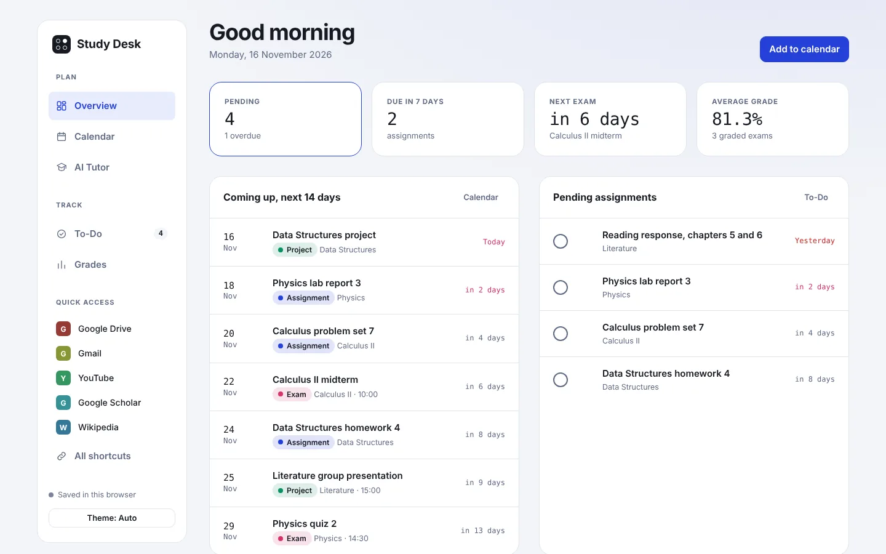
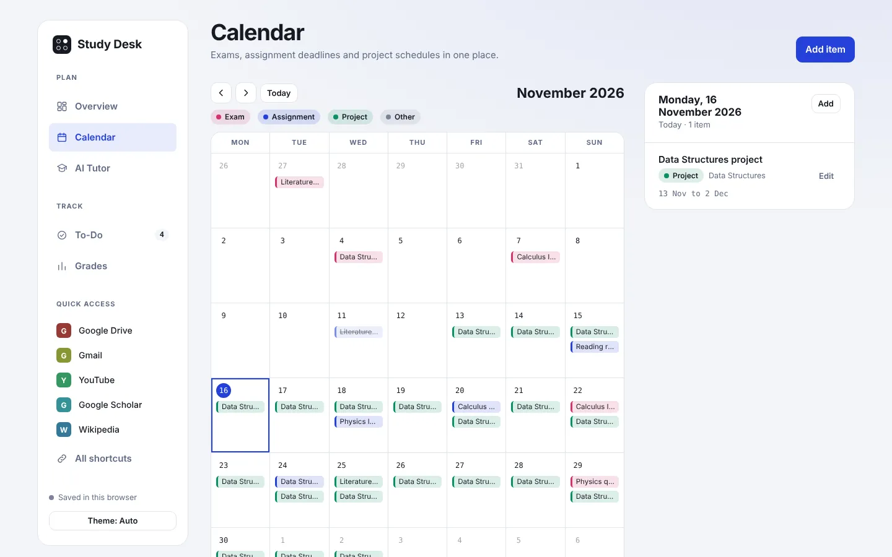
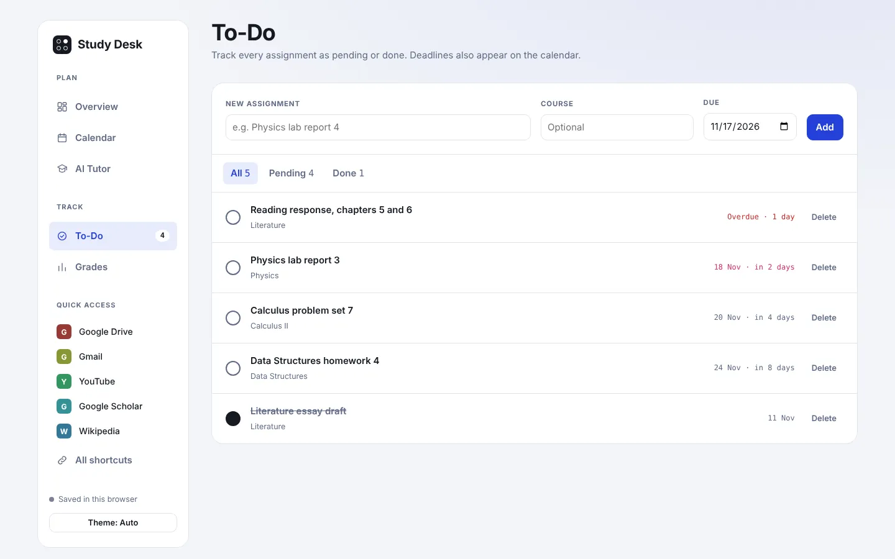
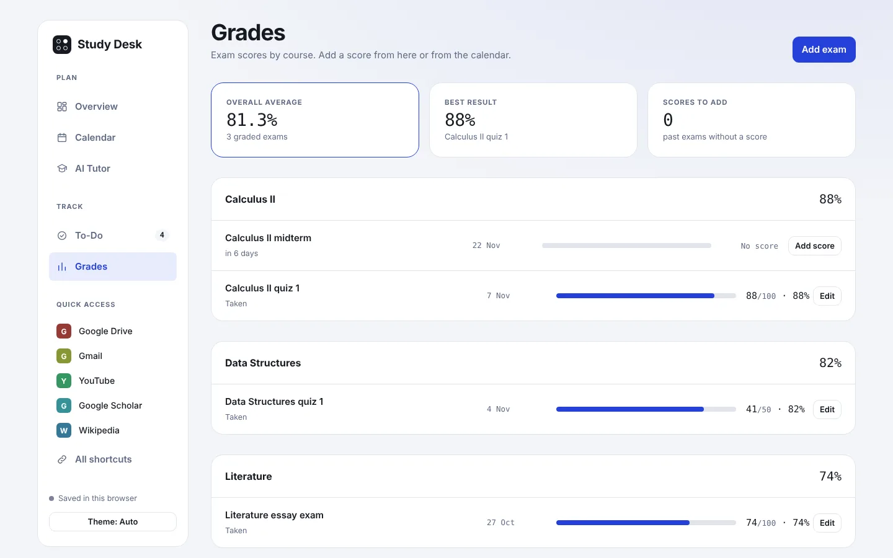

# Study Desk

A personal student planner: calendar, exams and grades, deadlines, to-dos, shortcuts and an AI Tutor.
Your planner data stays on your own device.

**[Download](https://denka1922.github.io/study-desk/)** · [Install and build guide](INSTALLATION.md) · [How sync works](SYNC.md) · [Test checklist](TEST-CHECKLIST.md)

[](https://denka1922.github.io/study-desk/)

| Calendar | To-Do | Grades |
|---|---|---|
|  |  |  |

The pictures show the example entries the app starts with.

Study Desk is one web page (`app/index.html`) that is packaged three ways:

| Platform | How it is packaged | Where it comes from |
|---|---|---|
| Windows | Electron program (installer and portable `.exe`) | built by GitHub Actions from a version tag |
| Mac | Electron program (`.dmg` and `.zip`, Apple Silicon and Intel; not signed by Apple) | built by GitHub Actions from a version tag |
| Android | Capacitor project | you build it in Android Studio (no APK is published on GitHub) |
| Web | a download page (`site/index.html`) | published with GitHub Pages |

**Download:** https://denka1922.github.io/study-desk/ has a tab for Windows, Mac and Android and always offers the newest version.

See [INSTALLATION.md](INSTALLATION.md) for step-by-step install and build instructions.

## Features

- **Calendar and deadlines** with to-dos and shortcuts to the sites you use.
- **Exams and grades** with averages.
- **Light and dark themes.**
- **AI Tutor** that can make a course outline, lessons, practice exams and revision, and answer questions. It has three ways to run (see below).
- **Sync between your PC and your phone.** Scan a QR code once; after that changes on one device appear on the other. Choose **Same Wi-Fi** (no account), **Over the internet** (through a free relay you set up yourself) or **Both**. Everything is encrypted, and your data never goes to any server of ours. How it works: `SYNC.md`.
- **No account and no server of ours.** Everything is stored on your device; sync goes directly between your devices (or through your own relay).

## The AI Tutor: three ways to run

Choose one on the Tutor setup screen.

| Mode | Where | How it works | Does your text leave the computer? |
|---|---|---|---|
| **Local** | Windows and Mac program only | Downloads an open model (NVIDIA Nemotron, GLM or Qwen3) and the open-source [llama.cpp](https://github.com/ggml-org/llama.cpp) engine once, then answers on your computer. | No |
| **CLI** | Windows and Mac program only | Uses an AI command-line tool you already have installed and signed in to: OpenAI Codex CLI, Gemini CLI or goose. | Usually yes: these tools mostly use a cloud service. The screen says so for each tool. |
| **Online key** | Everywhere, including Android and the web page | Your own API key for Gemini, OpenAI or Anthropic. | Yes, to the provider you choose |

Local mode details:

- It reads your computer (memory, processor cores, graphics card) and suggests a model.
- Five power levels (Light, Medium, High, Extra high, Max) limit how much memory and processor it may use.
- A token counter shows the last answer and the session total.
- Downloads are pinned to exact files and checked with a SHA-256 fingerprint before use.
- The catalog has nine models you can download, from about 2.5 GB (Qwen3 4B, Nemotron 3 Nano 4B) up to about 19 GB (Nemotron 3.5 Lightning and Nemotron 3 Nano 30B, GLM-4.7-Flash). The program picks the biggest one that fits your memory and the power level, and you can choose another one yourself.
- Models that no normal computer can run (Nemotron 3 Super 120B, Nemotron 3.5 Super VL 120B and Nemotron 3 Ultra 550B) are listed in a separate box as "too big", with what they need. They cannot be downloaded.
- Models in other languages: Qwen3 is strong in Turkish and many other languages; the Nemotron models are best in English. The screen warns you when a model is weak in the tutor language.

How the Tutor writes: the AI only writes plain lines, each starting with a short tag (`TITLE:`, `LESSON:`, `TIP:`, `NOTE:`, `WARN:`, `FORMULA:`, `STEP:`, `KEY:`, `Q:`, `ANSWER:` ...). The page reads the tags and draws the layout itself: tip, note and warning boxes, a formula block, numbered steps, key points and the quiz. This keeps answers short, so it is faster and uses fewer tokens, and the layout always matches the page's light and dark theme. A reply in JSON is still accepted.

Left out on purpose because they cannot be used safely in a one-question mode: GitHub Copilot CLI, opencode, Crush and aider.

Your API key is stored only on your device. Never share a key, and never commit one to a repository.

## Project layout

| Path | What it is |
|---|---|
| `app/` | `index.html`, the finished page. It is generated from source parts that are kept outside this repository (see Contributing). |
| `desktop/` | The Electron program. `main.js` (window and startup), `preload.js` (the only bridge to the page), `security.js` (link rules). |
| `desktop/sync/` | Sync, PC side: the Wi-Fi server, the relay client, encryption. Runs in the main process only and stays closed until you pair a phone. |
| `relay/` | The small internet relay (a free Cloudflare Worker you deploy yourself). It stores only encrypted data it cannot read. See `relay/README.md`. |
| `SYNC.md` | How sync works and the exact message formats. |
| `desktop/ai/` | The Local and CLI AI. It runs in the main process only; the page never gets a file path, command or port. |
| `mobile/` | The Android project (Capacitor). Open `mobile/android` in Android Studio. |
| `site/` | The download page. |
| `scripts/` | Helper scripts and all tests. |
| `.github/workflows/build.yml` | Tests every push, publishes the download page, and builds the Windows and Mac files and the Release from a version tag. |
| `.github/workflows/verify-catalog.yml` | Manual run **Verify AI catalog**: re-checks the model and engine fingerprints. |
| `.github/workflows/mac-check.yml` | Manual run **Mac check**: builds and runs the Mac app on real Macs at GitHub, including a real AI answer. |
| `INSTALLATION.md` | How to install, run and build. |
| `FIRST-BUILD.md` | From an empty repository to the first release. |
| `PLAY-STORE.md` | Android Studio and Google Play. |
| `TEST-CHECKLIST.md` | What to click through on each platform. |
| `PROJECT-MAP.md` | A short map of the code for contributors. |

## Sync in short

On the PC: **Sync**, pick how the devices find each other, a QR code appears. On the phone: **Sync**, **Scan the code**. Planner data (events, exams and grades, to-dos, shortcuts) and the AI Tutor courses are merged; the newest change wins, deletions travel, the AI key and AI settings never leave a device. Wi-Fi mode needs both apps open on the same Wi-Fi (Windows asks once whether to allow the program on private networks: allow it). Some school and guest Wi-Fi networks stop devices from seeing each other; use the internet option there. Details, limits and the security design are in `SYNC.md`.

## Tests

```
node scripts/check.js --ci     # Node 22 and Python 3 only (this is what GitHub runs)
node scripts/check.js          # all tests, including browser tests (needs Playwright)
```

## Status: what has and has not been tested

Automatic tests cover the page, settings, link rules, version handling, the download page, the workflow file and the whole Local/CLI code path.

**Not yet tested on real hardware:**

- starting the Windows program, the installer and the portable file;
- the Mac app on a Mac you can touch: it was run only on GitHub's Macs without a person (see below), so the first-open steps ("Open Anyway"), the downloaded `.dmg` and how it feels to use are still unchecked;
- building the Android project and running it on a phone;
- the Local and CLI AI on a real Windows PC or Mac. The automatic tests use fakes: no real model download, graphics card or signed-in command-line tool.

**Tested with real models (on a Linux computer at GitHub, processor only):** the real Tutor prompts and the real llama.cpp engine were run with Nemotron 3 Nano 4B, Nemotron 3.5 Bolt, Nemotron Nano 9B v2, Qwen3 4B, Qwen3 8B and GLM-4-9B. They wrote valid outlines, lessons, exams and revisions (also a Turkish lesson for Nemotron 3 Nano 4B, Nemotron 3.5 Bolt and Qwen3 8B). These runs found and fixed real problems: a 5 minute wait limit on slow computers, the engine "thinking" for minutes before answering, a model writing too many lessons, a model writing each question on one line, and models writing only three quiz questions or nine exam questions. **Sync was tested with the real PC code, the real relay code and the real page on both sides, using stand-ins only for the phone's network plug-in and the PC window (fake phone camera showing a real QR code included).** What has **not** been tested yet: a real Android phone (camera, native network call, Android's own network rules), the Windows firewall prompt, a real router, and the relay on a real Cloudflare account. `TEST-CHECKLIST.md` section J lists these steps. **Tested on real Macs (GitHub's Apple Silicon Mac with macOS 26 and Intel Mac with macOS 15, no person at the keyboard):** the workflow **Mac check** builds the Mac app, runs all tests on the Mac, opens the packaged app, checks it reads the Mac chip, downloads the real Mac engine and a real model, starts it and gets a real answer. Run it again any time: Actions, Mac check, Run workflow.

**Not run for real:** Nemotron 3.5 Lightning, Nemotron 3 Nano 30B and GLM-4.7-Flash (too big for that computer), and any model on Windows or Mac. Small models still make mistakes: always check what the Tutor tells you.

Use [TEST-CHECKLIST.md](TEST-CHECKLIST.md) to check these, and please open an issue if something fails.

## Libraries inside the page

GSAP (animation), `qrcode-generator` (draws the QR code, MIT) and `jsQR` (reads it with the camera, Apache-2.0) are copied into the page. Their licence notices are in `THIRD-PARTY-NOTICES.md`.

## Security notes

- The programs are **not code-signed** with a paid certificate. Windows shows "unknown publisher" and macOS asks you to allow the app once. See [INSTALLATION.md](INSTALLATION.md).
- No key, password or signing file belongs in this repository. `.gitignore` excludes keystores and `*.apk`, and a test fails if a keystore file appears.
- Local AI listens only on `127.0.0.1` with a random port and a one-time token.
- CLI mode runs the tool in read-only, one-question mode. Some tools can still read files on your computer, so never put passwords or other secrets in your questions.

## Contributing

`app/index.html` is generated from a set of page source parts and a build script that are **not part of this repository yet**. Until they are added, changes to the page itself are made by the maintainer; everything else (the Electron program, the AI code in `desktop/ai/`, the Android project, the download page, the scripts and the tests) can be changed here directly.

Write a failing test first, then the fix, and run `node scripts/check.js --ci` before opening a pull request.
